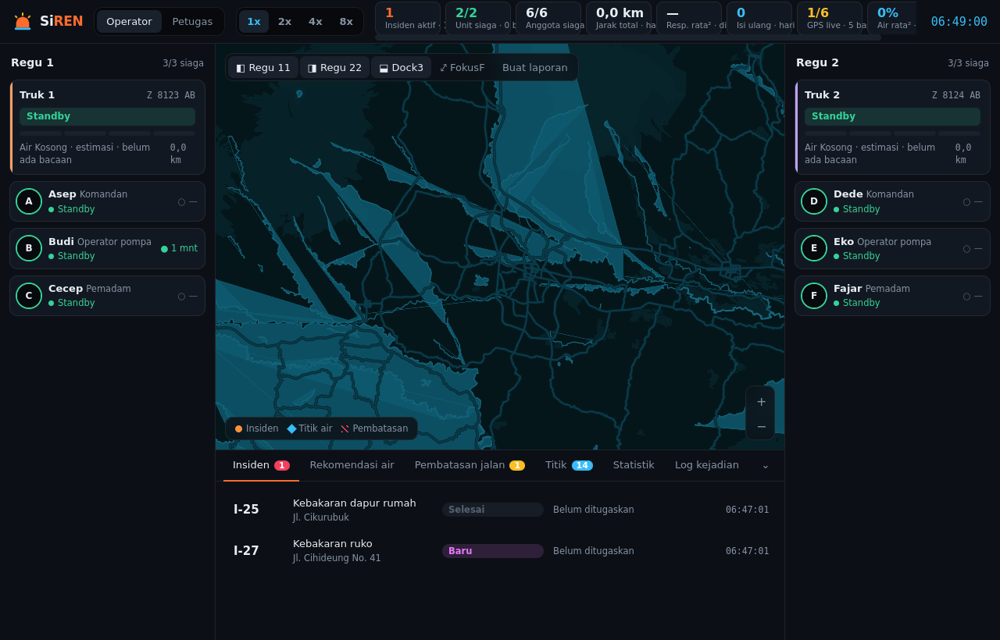
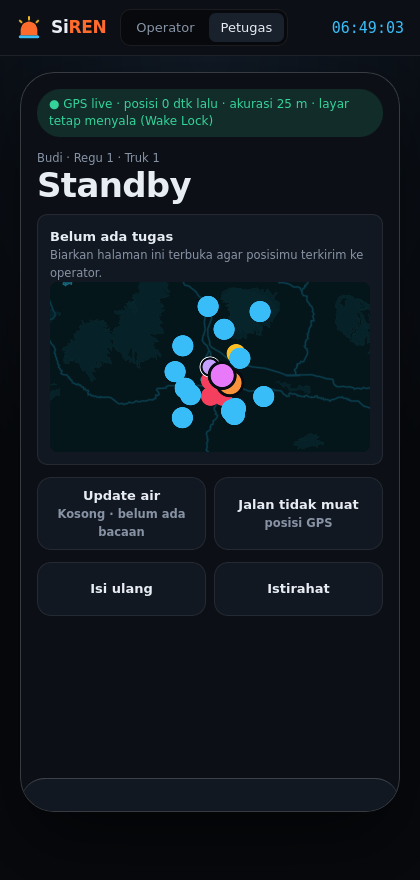
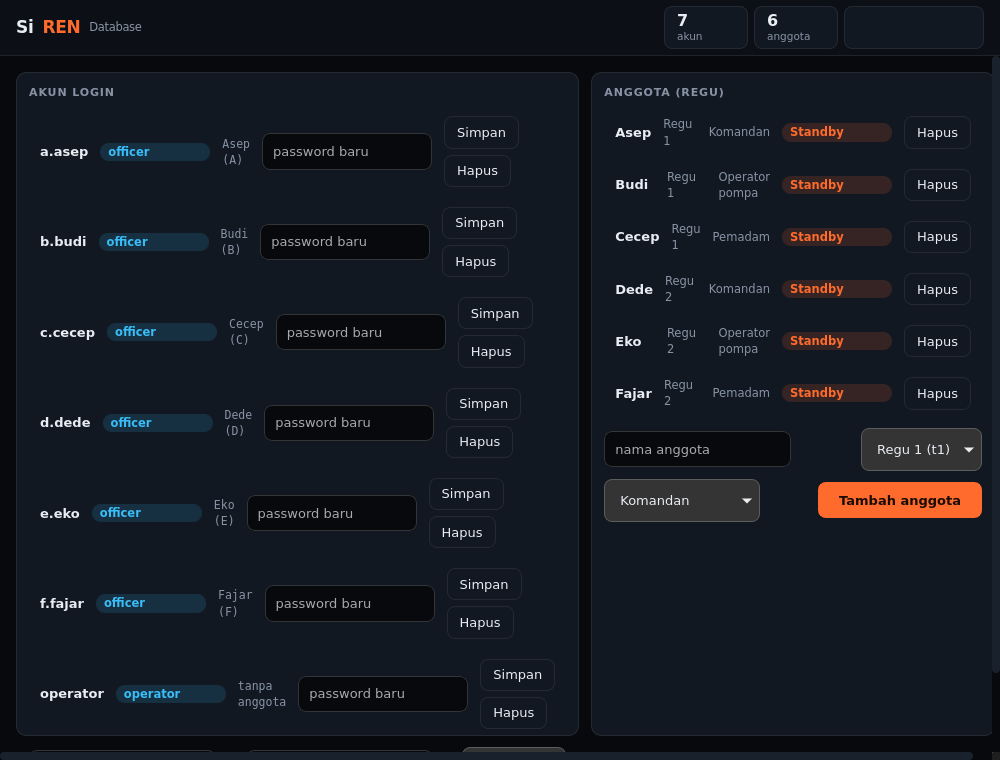

# SiREN — Fire-Brigade Response & Dispatch

**Si**liwangi + **REN**. A web app for fire-brigade operators: receive a fire report,
decide who gets sent where — crews, truck, water source, route, ETA — then track them
in real time. Radio and phone stay the emergency channel; SiREN never becomes the only
dispatch path.



The console: unit cards with live status, the map at the center (self-hosted blueprint
tiles over OSM), and a dock of working tabs — incidents, water recommendation, road
restrictions, point manager, statistics, event log.

## Two screens, one backend

| Screen | Who | What it does |
| --- | --- | --- |
| `/ops` | operator (laptop) | create incidents, pick crew + water, dispatch, verify restrictions, watch GPS pings |
| `/field` | petugas (phone) | sees the assignment, pings GPS every 5 s, changes duty status, reports water level and impassable roads |



The phone app: duty status, the assigned route's water state, a live mini-map, and one-tap
status transitions — all driven by the same WebSocket hub the operator uses.

## Run it

No Docker needed; everything installs inside `.sandbox/` (repo rule — nothing global).
One command sets up a fresh clone — idempotent, same flow on x86_64 and arm64:

```bash
./setup.sh -init   # venv + backend deps, Valhalla compile, routing tiles,
                   # PMTiles basemap, cloudflared, then a pytest smoke
                   # --dry-run prints the plan; --skip-osm skips the 1.7 GB extract
```

One launcher, three modes:

```bash
./setup.sh gamemode    # simulator on localhost — dev testing, opens /ops
./setup.sh realmode    # real data + Cloudflare tunnel — phones join from anywhere
./setup.sh database    # account & crew GUI, opens /db
```

`--fresh` on `realmode`/`database` archives the device DB to `.sandbox/data/archive/` and
resets the operational day (incidents/assignments/log cleared, crew back to Standby —
accounts and vehicles survive). gamemode always starts from a wiped scratch DB.

`realmode` uses the `cloudflared` binary `-init` placed in `.sandbox/bin/` and prints a
public HTTPS URL:
open it yourself as operator, hand the `/field/` URL to your crew — HTTPS at the tunnel
edge makes phone geolocation work without any certificates. Valhalla (real routing) is
started if available; without it the backend falls back to straight-line estimates.
`Ctrl+C` stops server, tunnel and Valhalla; the launcher refuses a busy port.

## x86_64 and arm64 — one installer, both arches

`-init` runs the same steps everywhere: `cloudflared` and `pmtiles` download per-arch,
while Valhalla + prime_server + spatialite tools + `osm_bbox` compile locally for the
machine's arch (`scripts/valhalla_compile.sh`; libosmium/protozero headers vendored from
the PyPI `osmium` sdist into `.sandbox/include`). `-init` reports missing apt packages
and never runs sudo — install them first:

```bash
sudo apt install g++ cmake libprotobuf-dev protobuf-compiler libspatialite-dev \
  libsqlite3-dev libcurl4-openssl-dev libzmq3-dev libczmq-dev libboost-dev \
  libgeotiff-dev liblz4-dev libluajit-5.1-dev libgeos-dev libssl-dev \
  libexpat1-dev libreadosm-dev zlib1g-dev git
```

The only arch difference is protobuf: Valhalla 3.9.3 SIGSEGVs on repeat `/route`
requests when linked against newer protobuf (Ubuntu 24.04 x86 ships 36; Ubuntu 26.10
arm64 ships 3.21.12, the version Valhalla pins). `valhalla_compile.sh` detects the
system version — on anything other than 3.21.12 it builds protobuf 3.21.12 into
`.sandbox/deps-pb` and a `valhalla_service.pb321` variant, which `setup.sh` and
`valhalla_keep.sh` prefer when present. Heavy builds: free RAM, `nice`, capped `-j`
(`THREADS` env). Routing tiles need `.sandbox/bin/osm_bbox` first — `-init` compiles it
(headers auto-vendored); the bbox crop comes from `contracts/config.yaml` geodata.

## One repo, one database per device

Each deployment keeps its own SQLite at `.sandbox/data/siren.sqlite` (never committed).
The seed loads only into a fresh database, so device A can run 3 people and device B
can run 5 — logins always match the database they live in. The GUI manages it:



Create and remove login accounts (role, password, optional link to a crew member), add
or remove crew members, and add or remove vehicles — the vehicle name is typed freely
(plat optional, type truck / motorbike / patrol car). Deleting a member or a vehicle
that is currently dispatched is refused; passwords are stored hashed and never returned
by the API. Everything is operator-only. Vehicle cards on `/ops` follow the database
live (add/remove shows up immediately), each card carrying both gauges: air and bensin.

## Architecture

- **Backend** — one FastAPI process: enum/config loader, dispatch state machine,
  Valhalla truck-profile routing with estimate fallback, water ranking + pump estimate,
  restriction queue (operators verify, per limitation L2), SQLite dev store, WebSocket hub.
- **Contracts first** — `contracts/openapi.yaml`, `contracts/events.json` + `events.md`,
  `contracts/db.sql`, `contracts/config.yaml` are the source of truth; UI fetches enum
  labels from `/config/{key}`, nothing is hard-coded.
- **Wire format** — snake_case JSON, positions `{lat, lon}`, WS envelope
  `{id, type, ts, v, payload}`; illegal transitions return 409 with the allowed list.
- **Enum values are Indonesian operational names** (`Baru`, `Dispatched`, `EnRoute`,
  `OnScene`, `Returning`, `IsiUlang`, `Istirahat`, `Selesai`) — UI copy stays Bahasa.
- **Map** — self-hosted PMTiles blueprint basemap served with byte-range responses,
  MapLibre vendored locally; incidents, water points and restriction polygons overlay it.

## Layout

| Path | Contents |
| --- | --- |
| `contracts/` | API, events, schema, config enums |
| `backend/siren/` | the backend modules |
| `backend/tests/` | 112 tests — API contract, state machine, water ranking, routing, store, daily reset |
| `seed/` | starter data (HQ station, teams, accounts, vehicles, water sources from OSM) |
| `apps/` | `ops/`, `field/`, `db/`, shared client + styles, vendored MapLibre, basemap data |
| `scripts/` | one-shot installer (`init.sh`), OSM crop, tile build, Valhalla graph build + keep loop, water seed |
| `infra/` | docker-compose for the future VPS deployment (PostGIS, Valhalla, tile server) |
| `.sandbox/` | installs and generated data — never committed |

## Tests

```bash
. .sandbox/py/bin/activate && pytest backend/tests -q   # or:
.sandbox/py/bin/python -m pytest backend/tests
```

Deterministic: injected clock, estimate provider, SQLite in a temp dir.

## Known limits

- **L1** notifications are never the only dispatch path — radio/phone stays the fallback.
- **L2** OSM rarely carries road-width tags, so restriction verification is operator-side, not automatic.
- **L3** Valhalla graph builds are memory-hungry; run them with free RAM and `nice`.
- **L4** dev password `siren-dev` is fine locally; rotate accounts before a public tunnel session.
- **L5** the pinned Valhalla build SIGSEGVs probabilistically under dev-laptop RAM pressure;
  `scripts/valhalla_keep.sh` restarts it and routing falls back to `estimate` with a warning
  while it is down. Production routing belongs on the VPS host.

Spec, decisions and open questions live in `docs/siren.md`; session history in
`docs/blackbox.md`; binding rules in `docs/rules.md` (`docs/` stays local by design).
